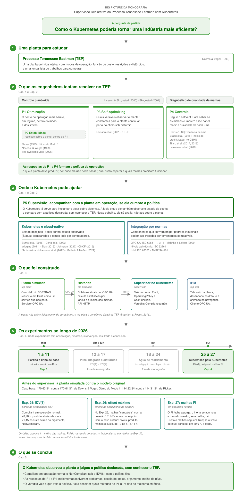

# Monografia — notas e referências

Como as fontes da monografia foram lidas, fichadas e organizadas. As notas ficam no vault Obsidian em [`../referencial/`](../referencial/), compartilhado com o artigo ([`../paper/`](../paper/)). Para compilar a monografia, ver [`../docs/doc_setup-latex-monografia.md`](../docs/doc_setup-latex-monografia.md).

## Big Picture

O caminho da monografia: da pergunta de partida ao TEP e aos problemas P1 a P5, o que foi construído, os experimentos e as conclusões. Só aparecem as fontes citadas na monografia.



---

## Inventário de Referências

### Artigos

| Título                                                                                     | Autores                                                              | Ano  | Periódico / Conferência                                 |
| ------------------------------------------------------------------------------------------ | -------------------------------------------------------------------- | ---- | ------------------------------------------------------- |
| A plant-wide industrial process control problem                                            | Downs, J.J.; Vogel, E.F.                                             | 1993 | Computers & Chemical Engineering, v.17, n.3             |
| An expert knowledge based methodology for online detection of signal oscillations          | Tilaro, F.; Bradu, B.; Gonzalez-Berges, M.; Roshchin, M.             | 2017 | CIVEMSA 2017                                            |
| Assessment of control loop performance                                                     | Harris, T.J.                                                         | 1989 | The Canadian Journal of Chemical Engineering, v.67, n.5 |
| Automatic PID performance monitoring applied to LHC cryogenics                             | Bradu, B.; Blanco Viñuela, E.; Marti, R.; Tilaro, F.                 | 2018 | ICALEPCS 2017 (proc. 2018)                              |
| Borg, Omega, and Kubernetes                                                                | Burns, B.; Grant, B.; Oppenheimer, D.; Brewer, E.; Wilkes, J.        | 2016 | ACM Queue, v.14                                         |
| Cloud-Native Computing: A Survey from the Perspective of Services                          | Deng, S. et al.                                                      | 2023 | arXiv:2306.14402                                        |
| Condition monitoring of bearing damage in electromechanical drive systems                  | Lessmeier, C.; Kimotho, J.K.; Zimmer, D.; Sextro, W.                 | 2016 | PHME 2016                                               |
| Control structure design for complete chemical plants                                      | Skogestad, S.                                                        | 2004 | Computers & Chemical Engineering, v.28, n.1             |
| Design of an IoT-PLC: A containerized programmable logical controller for the Industry 4.0 | Mellado, J.; Núñez, F.                                               | 2022 | Journal of Industrial Information Integration, v.25     |
| Kubernetes orchestration of high availability distributed control systems                  | Johansson, B.; Rågberger, M.; Nolte, T.; Papadopoulos, A.V.          | 2022 | IEEE ICIT 2022                                          |
| Model learning algorithms for anomaly detection in CERN control systems                    | Tilaro, F.; Bradu, B.; Gonzalez-Berges, M.; Varela, F.; Roshchin, M. | 2018 | ICALEPCS 2017 (proc. 2018)                              |
| Plantwide control — a review and a new design procedure                                    | Larsson, T.; Skogestad, S.                                           | 2000 | Modeling, Identification and Control, v.21              |
| UNICOS — a framework to build industry-like control systems                                | Gayet; Barillère                                                     | —    | CERN internal                                           |

### Normas

| Norma       | Título                                                                 | Organização          | Edição         |
| ----------- | ---------------------------------------------------------------------- | -------------------- | -------------- |
| IEC 62541-1 | OPC Unified Architecture — Part 1: Overview and concepts               | IEC / OPC Foundation | 2025           |
| IEC 62541-3 | OPC Unified Architecture — Part 3: Address space model                 | IEC / OPC Foundation | 2025 (ed. 4.0) |
| IEC 62541-8 | OPC Unified Architecture — Part 8: Data access                         | IEC / OPC Foundation | 2025 (ed. 4.0) |
| IEC 62264-1 | Enterprise-Control System Integration — Part 1: Models and terminology | IEC                  | 2013 (ed. 2.0) |

### Livros / Capítulos

| Título                               | Autores                    | Ano  | Livro / Editora                                              |
| ------------------------------------ | -------------------------- | ---- | ------------------------------------------------------------ |
| Digital Twin — The Simulation Aspect | Boschert, S.; Rosen, R.    | 2016 | Mechatronic Futures (Hehenberger & Bradley, Eds.) — Springer |
| \[capítulo CPS\]                     | Hehenberger et al.         | 2016 | Mechatronic Futures (Hehenberger & Bradley, Eds.) — Springer |
| Introduction                         | Mahnke, W.; Leitner, S.-H. | 2009 | OPC Unified Architecture — Springer                          |
| Services                             | Mahnke, W.; Leitner, S.-H. | 2009 | OPC Unified Architecture — Springer                          |
| System Architecture                  | Mahnke, W.; Leitner, S.-H. | 2009 | OPC Unified Architecture — Springer                          |

**Resumo:** 13 artigos + 4 normas + 5 capítulos = **22 notas de fonte**

---

## Estrutura do referencial (`referencial/`)

```
referencial/
├── .obsidian/          # configuração do vault Obsidian (plugins, graph, temas)
├── articles/           # PDFs de artigos vinculados via Annotator
├── bibTex/             # arquivos .bib de cada fonte
├── books/              # PDFs de livros
├── new/                # PDFs ainda sem nota de fonte
├── notes/              # notas de fonte (ft_*.md)
├── standard/           # PDFs de normas
└── big_picture_tcc_tep.svg
```

O vault do Obsidian é a pasta `referencial/`. Abra essa pasta no Obsidian, não a raiz do repositório.